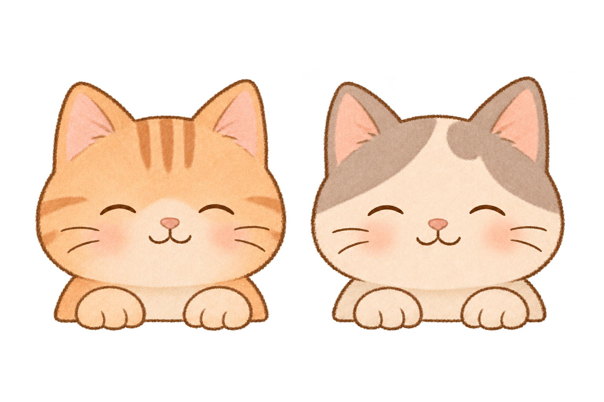

# Our Little Moments

一个面向两人的生活记录网站，目前采用月光浪漫风，仅制作桌面登录页面原型。

仓库：https://github.com/Y-L-07/Our-Little-Moments

## 当前进度

- 已切换为深蓝夜色、奶油金按钮和拱形窗框，保留居中登录卡片与双猫探头。背景采用静态弯月、星点、装饰星轨及两侧短句，适配常见桌面及笔记本窗口高度。
- 本轮只改视觉和页面说明，没有改账号字段、验证流程、猫咪交互或原型限制。星点不闪烁，不增加自动循环背景动画；原手账素材保留在仓库中。
- 已实现必填校验、密码显隐、密码聚焦捂眼、找回入口说明及演示提交反馈。
- 原始插画、透明 PNG 副本和完整生成提示词均已保留。
- 互动默认开启，按要求移除页面动画开关；眼睛外轮廓固定，内部深棕瞳孔平滑跟随鼠标，在 290px 宽猫咪区域中最大位移约 0.76px / 0.57px。脸部纹理、头部与表单保持稳定，鼠标离开页面时缓缓回正。
- 两只猫可分别用鼠标点击或键盘 Enter / Space 摸头，显示眯眼回应和不同的撒娇提示，约 2.2 秒后恢复；重复点击会重新计时。
- 鼠标摸猫不会抢走密码框焦点；密码聚焦时捂眼优先，并回应“嘘，我们不偷看。”。
- 系统开启“减少动态效果”时关闭跟随、眨眼和过渡；聚焦密码仍会即时切换成静态捂眼状态。

## 本地查看

使用 Node.js 24 LTS 和 npm。桌面测试使用本机安装的 Google Chrome，另下载 Firefox 与 WebKit 测试引擎。首次运行：

```sh
npm ci
npm run dev -- --port 3001
```

打开 http://127.0.0.1:3001 。页面只绑定本机，不部署到公网。

```sh
npm run typecheck
npx playwright install firefox webkit
npm test
npm run build
npm start -- --port 3001
```

`npm test` 使用测试配置中的 3000 端口，自动启动开发服务；已有服务时会复用。上述 `npm start` 命令在 3001 端口查看生产构建，请先结束占用同一端口的开发服务。浏览器测试截图、失败记录及 HTML 报告保存在 `artifacts/qa/`，不提交到仓库。

## 实现与目录

采用 Next.js App Router、TypeScript、Tailwind CSS 与原生表单/CSS，没有引入组件库或动画库。

- `src/app/`：唯一的登录页、页面信息与全局样式。
- `src/components/`：表单和双猫状态组件。
- `tests/`：桌面浏览器行为测试。

标题使用 Georgia，正文使用本机中文字体；手写感字体仅用于装饰，并使用系统可用字体，跨电脑可能略有差异。没有外链字体、统计脚本或第三方服务请求。

## 素材目录

- `public/images/cats/`：页面使用的三张猫咪状态素材。
- `assets/source/cats/`：生成原稿、来源、检查结果及生成提示词。
- [详细素材说明](assets/source/cats/README.md)
- `public/images/scrapbook/`：旧手账版的生成照片，当前月光版不加载；原稿、完整提示词与来源见 [背景素材说明](assets/source/scrapbook/README.md)。照片为虚构场景，不是用户的私人照片。新月亮、星点、窗框和装饰星轨由 CSS/SVG 绘制，没有引入新图片、图库、依赖或外链资源。

| 正常探头 | 捂眼睛 | 被摸头 |
| --- | --- | --- |
|  |  |  |

## 开发与同步约定

以本仓库为项目代码与素材的保存位置。每完成一项完整修改，先做与修改相应的检查，再提交并推送；确认远端已更新后再报告同步完成。具体要求见 [AGENTS.md](AGENTS.md)。

## 原型限制

本阶段只制作登录页面原型，不实现真实账号、认证、数据库、访问控制或隐私保护。不得在原型中输入真实账号和密码。暂不部署，不创建线上账号，不修改仓库的公开或私有设置。

输入仅由当前页面处理，不上传、记录或持久保存；演示提交后清空输入。保留粘贴与浏览器自动填充能力。脚本未就绪或 JavaScript 被关闭时，表单停用，避免退化成普通网络提交。

猫咪素材为内置图像生成工具生成的完整状态图片，不是可编辑分层文件。正常态保留静态原图，在原有眼睛轮廓内部叠加柔和棕色虹膜和深棕瞳孔，瞳孔通过 SVG 椭圆裁剪限定在眼内；没有覆盖毛发的遮罩、白眼白或拉动脸部的位移滤镜。跟随只移动内部瞳孔，使用短暂的动画帧缓动，到位后停止计算。通过 CSS 分别显示双猫图片的左右半幅，以状态图片实现眨眼、捂眼及被摸头回应；这些状态不叠加眼睛跟随。替换素材需重新标定眼睛坐标。猫咪组件只接收界面状态，不接收账号或密码。

当前只针对电脑测试，手机专用布局、触摸互动及软键盘适配暂未开发。

背景装饰均不可点击，并从辅助阅读中隐藏。1100px 以上桌面显示两侧月亮短句和装饰星轨；较窄窗口隐藏侧边装饰，避免挤占表单。

## 验证结果（2026-11-13）

- `npm run typecheck`：通过。
- `npm run build`：通过，登录页为静态预渲染页面。
- 本轮没有变更依赖；上次 `npm audit`（2026-11-12）结果为 0 个已知漏洞。
- `npm test`：42/42 通过，Google Chrome 159、Firefox 159 与 WebKit 27.2 各 14 项。
- 桌面尺寸：1280×800、1366×768、1440×900、1920×1080；3001 端口生产预览无横向溢出或资源错误，登录按钮和完整原型说明均在首屏可见。
- 已检查必填提示、键盘焦点、粘贴未被拦截、密码显隐、回车提交、密码聚焦捂眼、失焦恢复、眼睛跟随方向与范围，以及头部和表单位置稳定。
- 已检查独立摸头、重复点击恢复计时、键盘互动不提交表单、密码焦点不被鼠标摸头打断，以及系统减少动态效果的首次加载和实时切换。
- 已检查无 JavaScript 时停用表单、演示不导航及不写入存储、不发送输入内容。
- 已截图查看正常、摸头和密码聚焦状态，修正提示气泡在顶部轻微裁切的问题；三个桌面尺寸的气泡均完整可见。
- 跟随测试确认内部瞳孔随鼠标移动、四个眼框保持固定，原图没有位移滤镜；检查离开页面、窗口失焦、密码聚焦与减少动态效果时回正。
- 月光版检查了正文、次级文字、占位文字、按钮和错误提示的配色对比度，均超过 4.5:1；输入框边界对卡片背景为 3.38:1，焦点轮廓对输入框背景为 9.49:1。

月光版截图保存在本机 `artifacts/qa/moonlight-*.png`，早期手账版与眼睛效果截图仍保留；浏览器报告位于 `artifacts/qa/report/index.html`。WebKit 检查不等于实际 macOS Safari 测试；没有进行手机、真实密码管理器自动填充或屏幕阅读器实机测试。

视觉与交互实现参考已安装的 `web-design-engineer`；猫咪由 `imagegen` 和内置图像工具生成。框架用法核对了项目内 Next.js 文档及 [Next.js 官方安装说明](https://nextjs.org/docs/app/getting-started/installation)，浏览器配置参考 [Playwright 官方文档](https://playwright.dev/docs/test-configuration)。
