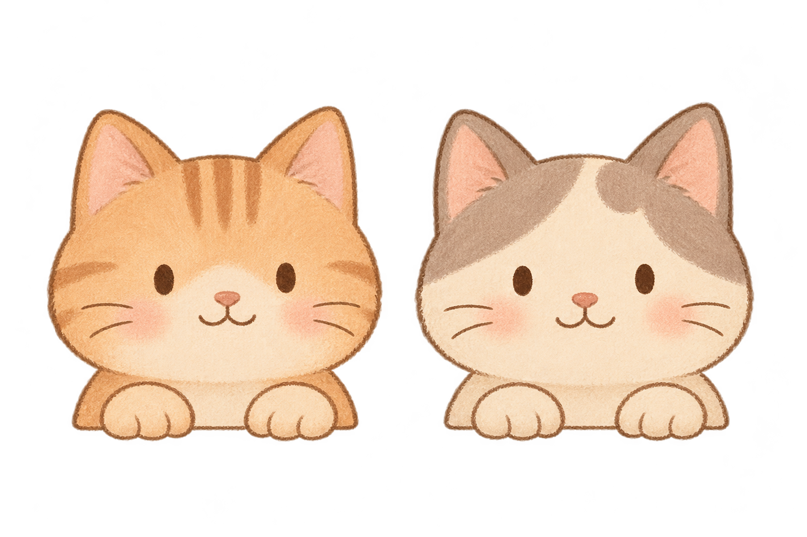
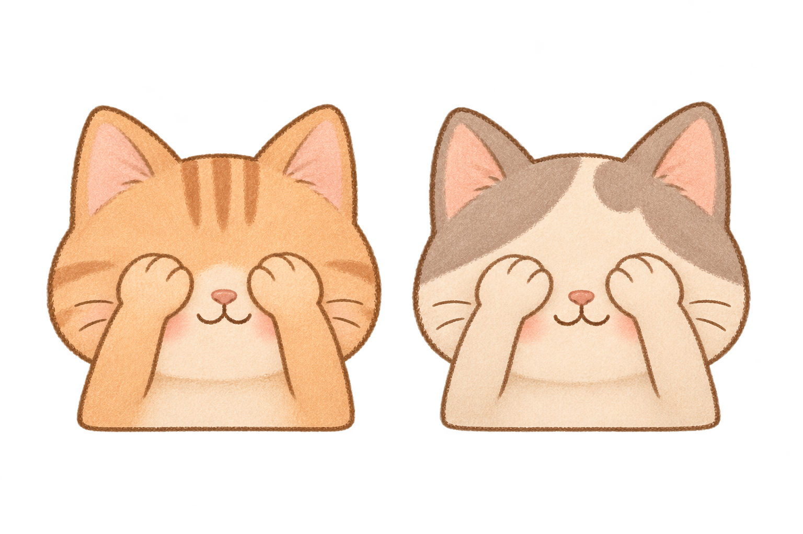

# Our Little Moments

一个面向两人的温暖手账风生活记录网站，目前仅制作桌面登录页面原型。

仓库：https://github.com/Y-L-07/Our-Little-Moments

## 当前进度

- 已完成纸感背景、居中登录卡片和双猫探头布局，适配常见桌面及笔记本窗口高度。
- 已实现必填校验、密码显隐、密码聚焦捂眼、找回入口说明及演示提交反馈。
- 原始插画、透明 PNG 副本和完整生成提示词均已保留。
- 已实现轻微鼠标视线跟随、错开的自然眨眼、演示提交的轻微开心动作及动画开关。
- 系统开启“减少动态效果”时关闭跟随、眨眼和过渡；聚焦密码仍会即时切换成静态捂眼状态。

## 本地查看

使用 Node.js 24 LTS 和 npm。桌面测试使用本机安装的 Google Chrome，另下载 Firefox 与 WebKit 测试引擎。首次运行：

```sh
npm ci
npm run dev
```

打开 http://127.0.0.1:3000 。页面只绑定本机，不部署到公网。

```sh
npm run typecheck
npx playwright install firefox webkit
npm test
npm run build
npm start
```

`npm test` 自动启动本地开发服务；已有服务时会复用。`npm start` 用于查看生产构建，请先结束占用同一端口的开发服务。浏览器测试截图、失败记录及 HTML 报告保存在 `artifacts/qa/`，不提交到仓库。

## 实现与目录

采用 Next.js App Router、TypeScript、Tailwind CSS 与原生表单/CSS，没有引入组件库或动画库。

- `src/app/`：唯一的登录页、页面信息与全局样式。
- `src/components/`：表单和双猫状态组件。
- `tests/`：桌面浏览器行为测试。

标题使用 Georgia，正文使用本机中文字体；手写感字体仅用于装饰，并使用系统可用字体，跨电脑可能略有差异。没有外链字体、统计脚本或第三方服务请求。

## 素材目录

- `public/images/cats/`：后续页面使用的猫咪素材。
- `assets/source/cats/`：生成原稿、来源、检查结果及生成提示词。
- [详细素材说明](assets/source/cats/README.md)

| 正常探头 | 捂眼睛 |
| --- | --- |
|  |  |

## 开发与同步约定

以本仓库为项目代码与素材的保存位置。每完成一项完整修改，先做与修改相应的检查，再提交并推送；确认远端已更新后再报告同步完成。具体要求见 [AGENTS.md](AGENTS.md)。

## 原型限制

本阶段只制作登录页面原型，不实现真实账号、认证、数据库、访问控制或隐私保护。不得在原型中输入真实账号和密码。暂不部署，不创建线上账号，不修改仓库的公开或私有设置。

输入仅由当前页面处理，不上传、记录或持久保存；演示提交后清空输入。保留粘贴与浏览器自动填充能力。脚本未就绪或 JavaScript 被关闭时，表单停用，避免退化成普通网络提交。

猫咪素材为内置图像生成工具生成的完整状态图片，不是可编辑分层文件。眼睛使用按现有图片校准的柔边遮罩和代码绘制的瞳孔，爪子通过完整状态图切换；替换图片后需要重新校准眼睛位置。猫咪组件只接收界面状态，不接收账号或密码。

当前只针对电脑测试，手机专用布局、触摸互动及软键盘适配暂未开发。
